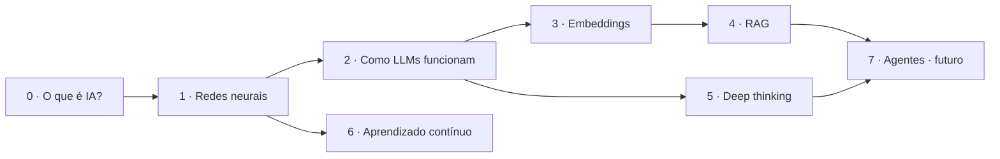
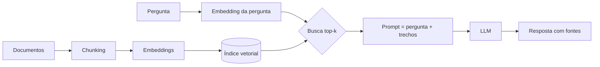

# 02 · Currículo

> ⚠️ **Em revisão.** Este documento é uma proposta da IA anterior ao [ADR-0013](adr/0013-formato-tutoriais-e-laboratorio.md). Hoje o produto é um **laboratório estilo Tinkercad** (produto principal) mais **tutoriais em páginas separadas**. As partes sobre "aulas em scrollytelling", "Abrir no Laboratório" e o núcleo compartilhado entre aula e laboratório não valem mais e serão reescritas.

> Trilha sugerida, mas cada módulo funciona sozinho. Cada aula tem: **objetivo**, **fluxo visual**, **experimento no laboratório** e **checkpoint**.

## Mapa da trilha

Cada módulo tem uma **cor de acento** própria (ver [04-design-system.md](04-design-system.md#22-cores-por-módulo)), que ajuda o aluno a se localizar.

---

## Módulo 0 · O que é IA? *(fundamentos)*

**Objetivo:** desfazer a ideia de "mágica". IA = função que aprende com exemplos.

| Aula | Ideia-chave | Visual |
|---|---|---|
| 0.1 Regras vs. exemplos | Programar regras × aprender com dados | Duas "caixas" lado a lado classificando frutas |
| 0.2 Um modelo é uma função | Entrada → números → saída | Fluxo de uma foto virando pixels e virando "gato: 92%" |
| 0.3 Treinar = ajustar botões | Parâmetros são botões ajustados para errar menos | Reta se ajustando a pontos (regressão linear) |

**Laboratório:** arrastar pontos no plano e ver a reta se ajustar em tempo real.

## Módulo 1 · Redes neurais

**Objetivo:** entender neurônio, camadas, perda e aprendizado (gradiente descendente + backprop) sem precisar de cálculo.

| Aula | Ideia-chave | Visual |
|---|---|---|
| 1.1 O neurônio | Soma ponderada + ativação | Neurônio com pesos como "espessura" das conexões |
| 1.2 Camadas | Combinar neurônios cria fronteiras complexas | Fronteira de decisão se dobrando a cada camada |
| 1.3 O erro (perda) | Como medir o quanto o modelo errou | Barras de erro por exemplo, somando numa "nota" |
| 1.4 Descendo a montanha | Gradiente descendente | Bolinha rolando numa superfície de perda 3D |
| 1.5 Backpropagation | A culpa do erro volta pela rede | Pulso de cor viajando de trás para frente |
| 1.6 Overfitting | Decorar ≠ aprender | Curvas de treino × validação se separando |

**Laboratório "Playground Neural":** dataset 2D (círculos, espiral, XOR), escolher camadas/neurônios/ativação/taxa de aprendizado, treinar passo a passo ou contínuo, inspecionar qualquer neurônio.

**Camada opcional "ver por dentro":** fórmulas reais aparecem num painel que pode ser expandido.

## Módulo 2 · Como LLMs funcionam

**Objetivo:** um LLM é uma rede que prevê o próximo token — e isso, em escala, parece "pensar".

| Aula | Ideia-chave | Visual |
|---|---|---|
| 2.1 Tokens | Texto vira pedaços numerados | Frase se quebrando em blocos coloridos |
| 2.2 Próximo token | O modelo dá probabilidades para o próximo pedaço | Barras de probabilidade, escolha, repete |
| 2.3 Temperatura | Criatividade × previsibilidade | Mesmas barras achatando / afinando |
| 2.4 Atenção | Cada palavra "olha" para as outras | Linhas de atenção entre palavras com espessura |
| 2.5 Treino e ajuste fino | Pré-treino → instrução → preferências | Linha do tempo com três estágios |
| 2.6 Alucinação | Por que o modelo inventa | Probabilidades plausíveis, porém falsas |

**Laboratório "Tokenizador & Amostragem":** digitar texto e ver tokens; ajustar temperatura/top-p e ver a distribuição mudar (replay de um modelo real + modelo de bigramas local).

## Módulo 3 · Embeddings e busca semântica

**Objetivo:** significado vira posição num espaço; parecido = perto.

| Aula | Ideia-chave | Visual |
|---|---|---|
| 3.1 Palavras como coordenadas | Vetores | Palavras como pontos num mapa 2D |
| 3.2 Distância = semelhança | Similaridade de cosseno | Ângulo entre setas |
| 3.3 Busca semântica | Achar por significado, não por palavra exata | Consulta "caindo" no mapa e puxando os vizinhos |

**Laboratório "Mapa de Significados":** o aluno escreve frases, elas são transformadas em embeddings **no navegador** e aparecem num mapa 2D (projeção). Busca por similaridade ao vivo.

## Módulo 4 · RAG (Retrieval-Augmented Generation)

**Objetivo:** entender o pipeline completo e **por que** ele reduz alucinação — e onde ele falha.

| Aula | Ideia-chave | Visual |
|---|---|---|
| 4.1 O problema | O LLM não sabe dos *seus* documentos | Modelo com "memória" congelada numa data |
| 4.2 Indexação | Chunking + embeddings + índice | Documento sendo fatiado e virando pontos |
| 4.3 Recuperação | Top-k por similaridade | Pergunta puxando os k trechos mais perto |
| 4.4 Geração aumentada | Montar o prompt com contexto | Prompt sendo "montado" peça por peça |
| 4.5 Quando dá errado | Chunk ruim, k errado, pergunta ambígua | Comparação lado a lado: bom × ruim |
| 4.6 RAG × fine-tuning × contexto longo | Quando usar cada um | Tabela de decisão interativa |

**Laboratório "Monte seu RAG":** colar textos (ou usar coleções prontas), ajustar tamanho de chunk, sobreposição e k, ver quais trechos são recuperados e o prompt final. Geração em modo *replay* (padrão) ou *ao vivo* (ver [ADR-0006](adr/0006-llm-replay-e-ao-vivo.md)).

## Módulo 5 · Deep thinking (raciocínio)

**Objetivo:** entender o que muda quando o modelo "pensa antes de responder".

| Aula | Ideia-chave | Visual |
|---|---|---|
| 5.1 Resposta direta × pensada | Cadeia de raciocínio (chain-of-thought) | Duas respostas lado a lado com o "rascunho" visível |
| 5.2 Gastar computação na hora | *Test-time compute*: mais tokens de pensamento → mais acerto em problemas difíceis | Gráfico orçamento de pensamento × acerto |
| 5.3 Explorar e verificar | Tentar caminhos, conferir, voltar atrás | Árvore de raciocínio com ramos descartados |
| 5.4 Limites | Pensar mais não conserta falta de informação | Exemplo onde pensar não ajuda |

**Laboratório "Orçamento de Pensamento":** escolher um problema (lógica, matemática, planejamento), escolher o orçamento de raciocínio e comparar traços e respostas (replays gravados de modelos reais com *extended thinking*; ao vivo opcional).

## Módulo 6 · Aprendizado contínuo

**Objetivo:** por que modelos não "aprendem sozinhos com o uso" e o que existe para isso.

| Aula | Ideia-chave | Visual |
|---|---|---|
| 6.1 Esquecimento catastrófico | Treinar na tarefa B apaga a tarefa A | Acurácia de A despencando enquanto B sobe |
| 6.2 Replay | Misturar exemplos antigos | Buffer de memória alimentando o treino |
| 6.3 Proteger pesos importantes | Ideia do EWC (regularização) | Pesos "travados" com cadeado de intensidade variável |
| 6.4 Memória externa | RAG e memória como alternativa a re-treinar | Modelo fixo + caderno de anotações que cresce |

**Laboratório "Não Esqueça":** treinar uma rede pequena em tarefa A, depois em B, com/sem replay e com/sem regularização — gráficos de acurácia por tarefa ao vivo.

## Módulo 7 · Agentes *(futuro)*

Ferramentas, laço pensar → agir → observar, memória. Planejado para a fase 3 (ver [06-roadmap.md](06-roadmap.md)).

---

## Estrutura padrão de uma aula

1. **Gancho** (1 tela): pergunta ou situação do dia a dia.
2. **Fluxo** (5–12 passos de scroll): cada passo muda uma coisa na visualização.
3. **"Onde a metáfora quebra"** (caixa destacada).
4. **Experimente** (mini-interação embutida + botão "Abrir no Laboratório").
5. **Checkpoint** (2–4 perguntas, feedback imediato explicado).
6. **Ver por dentro** (opcional): fórmulas, pseudocódigo, links para aprofundar.

Duração alvo: **8–15 minutos** por aula.
