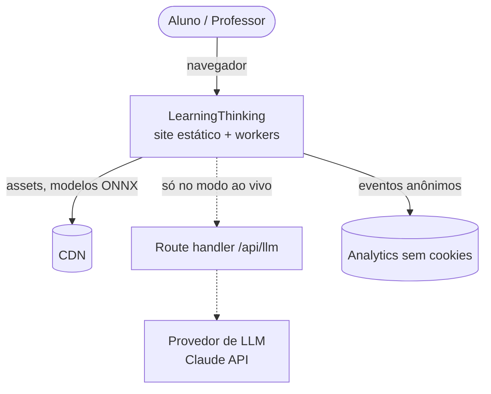
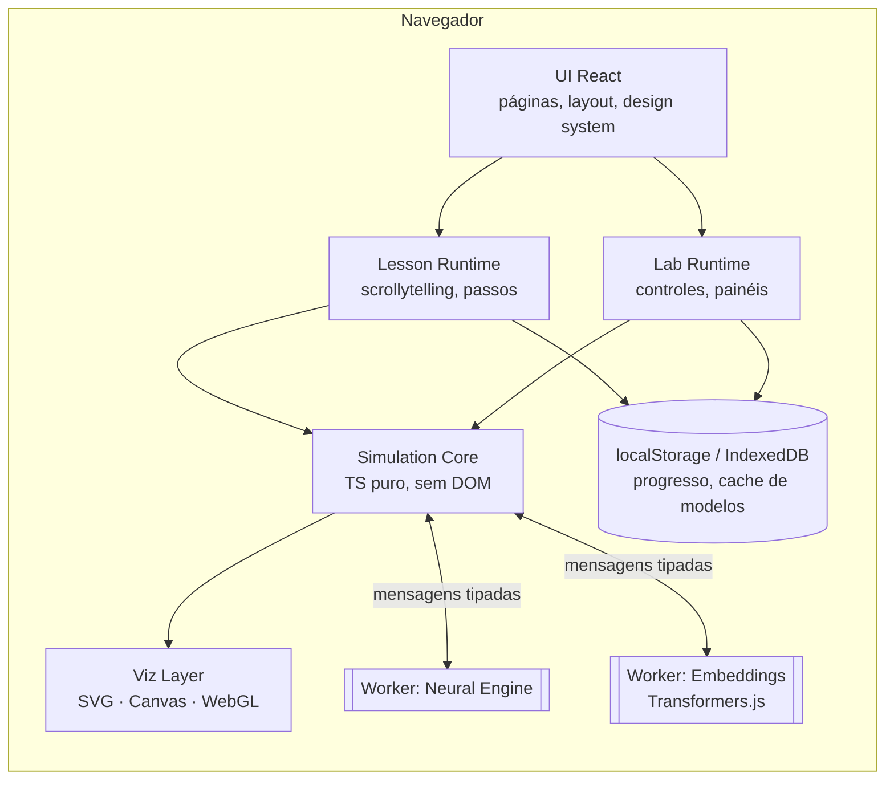
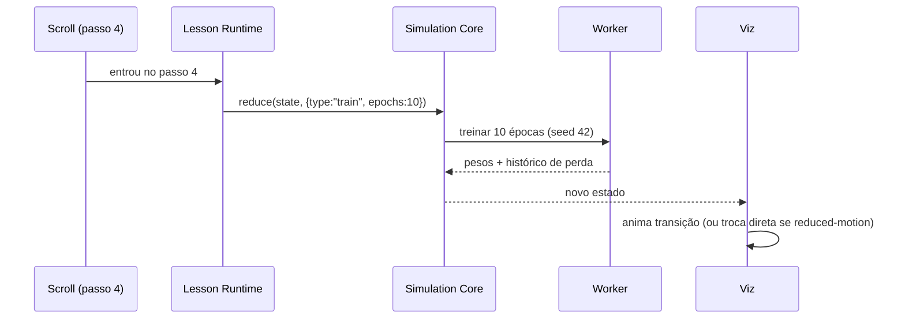

# 03 · Arquitetura

> ⚠️ **Em revisão.** Este documento é uma proposta da IA anterior ao [ADR-0013](adr/0013-formato-tutoriais-e-laboratorio.md). Hoje o produto é um **laboratório estilo Tinkercad** (produto principal) mais **tutoriais em páginas separadas**. As partes sobre "aulas em scrollytelling", "Abrir no Laboratório" e o núcleo compartilhado entre aula e laboratório não valem mais e serão reescritas.
>
> **O que já vale (2026-10-19):** a stack real está no [ADR-0017](adr/0017-stack.md): Next.js, TypeScript, Tailwind, GSAP, React Flow, cálculo próprio em TypeScript, localStorage, sem backend na v1. O editor do laboratório já foi validado no teste técnico [`spikes/camada-react-flow/`](../spikes/camada-react-flow/README.md). Lá, as regras ficam separadas da tela em `lib/rede.ts`: blocos, fios, pesos, a "rodada" com a lista de contas em ordem e a "vista" do que aparece em cada passo.

> Visão geral técnica. As decisões individuais e seus porquês estão nos [ADRs](adr/README.md).

## 1. Resumo em uma frase

Um site **estático-primeiro** em Next.js + TypeScript, onde aulas são MDX com componentes interativos, e **toda a "IA" didática roda no navegador** (Web Workers) sobre um **núcleo de simulação compartilhado** entre aula e laboratório. Um backend mínimo existe só para o modo LLM "ao vivo".

## 2. Drivers de arquitetura

| Driver | Consequência |
|---|---|
| Zero atrito (sem conta, sem chave) | Tudo funciona no cliente; LLM real é opcional ([ADR-0006](adr/0006-llm-replay-e-ao-vivo.md)) |
| Custo perto de zero | Páginas estáticas em CDN; nada de GPU no servidor |
| Visual premium e fluido (60 fps) | Computação pesada fora da thread principal; SVG/Canvas conforme o volume ([ADR-0008](adr/0008-animacao-e-visualizacao.md)) |
| Aula e sandbox mostram o mesmo modelo | Núcleo de simulação puro e compartilhado ([ADR-0004](adr/0004-nucleo-de-simulacao-compartilhado.md)) |
| Professor quer escrever aulas rápido | Conteúdo em MDX versionado no Git ([ADR-0003](adr/0003-conteudo-em-mdx.md)) |
| Público amplo, uso em sala | Acessibilidade e *reduced motion* são requisitos ([ADR-0011](adr/0011-acessibilidade-e-movimento.md)) |

## 3. Visão de contexto (C4 nível 1)



## 4. Visão de contêineres (C4 nível 2)



### Responsabilidades

| Camada | Faz | Não faz |
|---|---|---|
| **UI** | Navegação, layout, tema, componentes de design system | Lógica de IA |
| **Lesson Runtime** | Liga passos de scroll a estados da simulação; pausa/volta; checkpoint | Calcula nada de ML |
| **Lab Runtime** | Expõe parâmetros da simulação como controles; presets; compartilhar estado via URL | Conhece conteúdo de aula |
| **Simulation Core** | Estado + ações + `step()` determinístico por tópico; serializável | Toca no DOM ou em React |
| **Viz Layer** | Desenha o estado; anima transições | Muda o estado |
| **Workers** | Treino de redes, inferência de embeddings, busca vetorial | Renderização |

## 5. O conceito central: Simulação

Cada tópico (rede neural, RAG, embeddings…) é uma **Simulação** com o mesmo contrato:

```ts
interface Simulation<State, Action, Params> {
  id: string;                         // "neural-playground", "rag-pipeline"
  init(params: Params, seed: number): State;
  reduce(state: State, action: Action): State;   // puro e determinístico
  step?(state: State): Promise<State>;           // avanço de tempo (ex.: 1 época), pode ir ao worker
  serialize(state: State): string;               // para URL / "Abrir no Laboratório"
  deserialize(raw: string): State;
}
```

- A **aula** é um *roteiro*: uma lista de passos, cada um com um `Action` (ou estado-alvo) e o texto correspondente.
- O **laboratório** é a mesma simulação com controles livres.
- "Abrir no Laboratório" = `serialize(estadoAtual)` → `/lab/<id>?s=...`.
- Determinismo (seed fixa) garante que a aula sempre mostre a mesma coisa e que testes sejam reprodutíveis.



## 6. Estrutura de pastas (proposta)

```
LearningThinking/
├─ docs/                      # esta documentação + ADRs
├─ content/
│  └─ pt-BR/
│     ├─ 00-o-que-e-ia/
│     │  └─ 01-regras-vs-exemplos.mdx
│     └─ 04-rag/ ...
├─ public/
│  ├─ models/                 # modelos ONNX pequenos (ou baixados sob demanda)
│  └─ replays/                # traços pré-gravados de LLM (JSON)
├─ src/
│  ├─ app/                    # rotas Next.js (App Router)
│  │  ├─ (marketing)/page.tsx
│  │  ├─ aulas/[modulo]/[aula]/page.tsx
│  │  ├─ lab/[sim]/page.tsx
│  │  └─ api/llm/route.ts     # único endpoint de servidor
│  ├─ design-system/          # tokens, primitivos, componentes
│  ├─ lesson/                 # Lesson Runtime (Scrolly, Step, Checkpoint)
│  ├─ lab/                    # Lab Runtime (ControlPanel, Presets, ShareLink)
│  ├─ sims/                   # um diretório por simulação
│  │  └─ neural/
│  │     ├─ core.ts           # Simulation (puro)
│  │     ├─ worker.ts
│  │     ├─ viz/              # componentes de visualização
│  │     └─ core.test.ts
│  ├─ engine/                 # mini-engine de redes neurais (autograd didático)
│  ├─ workers/                # infraestrutura de workers (Comlink)
│  └─ lib/                    # utilidades, i18n, analytics
└─ tests/e2e/                 # Playwright
```

**Regras de dependência** (verificadas por lint):

- `sims/*/core.ts` e `engine/` **não importam** React, DOM nem Next.
- `lesson/` e `lab/` não importam nada de uma simulação específica — só do contrato `Simulation`.
- `design-system/` não importa nada do resto do app.

## 7. Fluxos de dados

### 7.1 Embeddings e RAG no navegador

1. Na primeira vez, o worker baixa um modelo de embeddings pequeno (ex.: `all-MiniLM-L6-v2` quantizado, ~25 MB) e guarda em cache (Cache API / IndexedDB).
2. Usa **WebGPU** quando disponível e **WASM** como fallback.
3. Índice vetorial em memória (vetores normalizados + produto escalar). Para coleções didáticas (< 5 mil chunks) busca exata é instantânea — não precisamos de HNSW.
4. Coleções prontas vêm com **embeddings pré-calculados** em `public/`, então o modelo só é baixado se o aluno escrever texto novo.

### 7.2 Geração por LLM

| Modo | Como funciona | Quando |
|---|---|---|
| **Replay** (padrão) | JSON gravado com tokens, tempos, probabilidades e traço de raciocínio; reproduzido com "streaming" simulado | Sempre disponível, offline, determinístico |
| **Ao vivo** | `POST /api/llm` → provedor (Claude API), com streaming | Professor habilita com código de turma; rate limit por IP/turma |

Detalhes e riscos em [ADR-0006](adr/0006-llm-replay-e-ao-vivo.md).

## 8. Estado e persistência

| Tipo de estado | Onde vive |
|---|---|
| Estado da simulação | Store local por página (Zustand) + serializado na URL quando compartilhado |
| Progresso nas aulas | `localStorage` (versão do schema + migração) |
| Modelos baixados | Cache API |
| Preferências (tema, velocidade de animação) | `localStorage` + respeita `prefers-*` do sistema |

Sem contas no MVP ([ADR-0009](adr/0009-sem-backend-no-mvp.md)). A fase de turmas (painel do professor) é desenhada em [06-roadmap.md](06-roadmap.md).

## 9. Performance

- Orçamento de JS na primeira carga de uma aula: **< 150 KB gz** (simulação e workers carregam sob demanda, quando a visualização entra na tela).
- Treino e inferência sempre em worker; a thread principal só recebe estados prontos.
- Renderização: SVG até ~1 000 elementos; acima disso, Canvas 2D; 3D só onde agrega (superfície de perda) via WebGL.
- Animações por `transform`/`opacity`; nada de animar layout.

## 10. Segurança e privacidade

- Textos que o aluno digita no sandbox **não saem do navegador**, exceto no modo ao vivo (com aviso explícito na interface).
- `/api/llm`: chave só no servidor, limite de tokens por requisição, rate limit, lista de modelos permitidos, *system prompt* fixo do lado do servidor.
- CSP restritiva; sem scripts de terceiros além do analytics.

## Observabilidade

- Analytics sem cookies e sem dados pessoais (ex.: Plausible ou Vercel Analytics) com eventos: `lesson_started`, `step_reached`, `lab_opened`, `checkpoint_answered`.
- Erros de cliente agrupados (ex.: Sentry) com amostragem baixa e sem conteúdo digitado pelo aluno.

## 11. Qualidade

| Camada | Ferramenta | O que cobre |
|---|---|---|
| Unidade | Vitest | `engine/`, `sims/*/core.ts` (determinismo, gradientes conferidos numericamente) |
| Componentes | Vitest + Testing Library | Lesson/Lab runtime, controles |
| Visual | Storybook + snapshots | Design system e visualizações |
| E2E | Playwright | Percorrer uma aula, abrir no laboratório, checkpoint |
| A11y | axe (no Playwright) + revisão manual | Toda página |

Detalhes de hospedagem e CI em [ADR-0012](adr/0012-hospedagem-e-ci.md).
