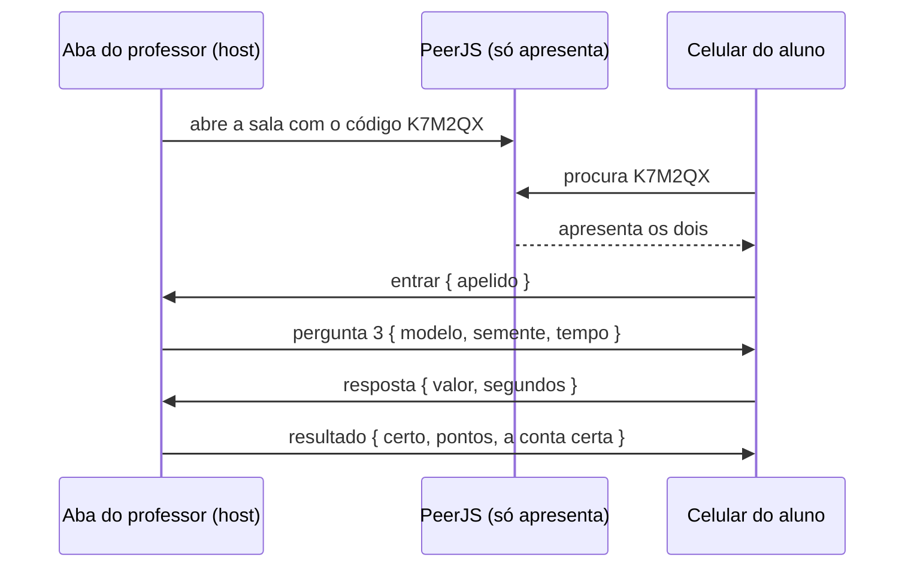

# ADR-0034 · Quiz ao vivo: o professor abre uma sala, a turma entra com um código

- **Status:** Aceita (autor, 2026-11-13); detalhes técnicos propostos pela IA. Telas no Figma revisadas pelo autor; falta código.
- **Data:** 2026-11-13
- **Decisores:** Eduardo (autor), com propostas da IA
- **Usa:** [ADR-0024](0024-treinar-com-backpropagation.md) (a conta do forward e do backward em `web/lib/treino.ts`), [ADR-0025](0025-bloco-backward-pass.md) (sinais + − =, culpa), [ADR-0028](0028-aba-da-aqua.md) (faixas 0,30 / 0,70 e as poses da Aqua), [ADR-0033](0033-publicar-no-github-pages.md) (site estático, sem servidor)
- **Conversa com:** [ADR-0009](0009-sem-backend-no-mvp.md) (sem contas nem banco). Ela dizia "o professor não vê o desempenho da turma"; esta ADR resolve isso **na aula**, sem contas e sem guardar nada.

## Contexto

O autor quer usar o site nas aulas com um quiz parecido com o Kahoot: o professor (o *host*) abre uma sala no computador dele, os alunos entram com um código e respondem pelo celular. No fim, o professor vê as respostas de cada aluno em cards e quem acertou mais e quem errou mais.

Três exigências do autor:

1. **O conteúdo é o do laboratório.** Cores viram números (R G B de 0 a 1), azul = 0 e laranja = 1, pesos, soma, ReLU, sigmoide, forward pass, erro, backward pass, treino. Nada que o lab ainda não tem (sem *bias*, sem softmax).
2. **Os números mudam sempre.** O mesmo tema não pode ter sempre as mesmas respostas, para o aluno não decorar. A cor, os pesos e a rede desenhada são sorteados a cada quiz.
3. **O professor escolhe o tema.** "Geral" cobra tudo o que o lab tem; "Só forward" serve para uma turma que ainda não viu backpropagation.

Exemplos que o autor deu, todos com a **rede desenhada igual à do laboratório**:

- "O amarelo (R 1 · G 0,8 · B 0) deu soma 3,6 e a Aqua disse 'É laranja!' com 0,97. Ela acertou?"
- "O verde (R 0 · G 1 · B 0) dá 0,50 cravado. Dica: os dois neurônios da camada oculta ouvem o G com o **mesmo** peso. O que isso faz com a soma da saída?" (aqui o aluno **coloca o número no desenho**, em vez de ler a explicação)
- "1. A resposta devia ter sido MAIOR ou MENOR?"
- "2. A linha neurônio laranja → saída (peso −1) deve SUBIR, DESCER ou NÃO MUDAR?"
- "4. A linha B → neurônio laranja muda? Por quê?"

### O problema técnico: o site não tem servidor

O site está no GitHub Pages ([ADR-0033](0033-publicar-no-github-pages.md)), que só entrega arquivos prontos. Num Kahoot, o servidor da empresa recebe as respostas de todo mundo. Aqui não existe esse servidor.

## Opções consideradas (conexão)

1. **A aba do professor vira o "servidor", pelo próprio site (WebRTC).** *WebRTC* (Web Real-Time Communication) é o recurso do navegador que deixa dois navegadores conversarem direto, sem um servidor no meio guardando as mensagens (é o que as chamadas de vídeo no navegador usam). O professor clica em "Criar sala" e a aba dele recebe as respostas, corrige e soma os pontos. Para os dois navegadores se acharem, é preciso um "apresentador" (a *sinalização*, em inglês *signaling*): o **PeerJS**, uma biblioteca com um serviço público gratuito que faz só essa apresentação. Depois disso, as respostas vão direto do celular do aluno para a aba do professor.
2. **Um servidor no computador do professor.** Um programa em Node roda na máquina dele, e os alunos, **na mesma Wi-Fi**, digitam o endereço (ex.: `192.168.0.12:3000`). Exige instalar o programa e liberar o firewall. Além disso, muita Wi-Fi de escola tem *isolamento de cliente* (um aparelho não enxerga o outro), e aí não funciona.
3. **Um serviço online com banco** (Firebase, Supabase). Mais robusto com muita gente, mas precisa de conta, e os dados dos alunos (muitos menores) ficam num servidor de fora, com a LGPD a cuidar.

## Decisões do autor (2026-11-13)

1. **Conexão pelo próprio site** (opção 1, WebRTC + PeerJS). **Não precisa ser a mesma Wi-Fi:** funciona em qualquer rede, até no 4G do aluno. Nada é instalado e nada fica guardado em servidor.
2. **Todos juntos, estilo Kahoot.** O professor projeta a pergunta, todos respondem ao mesmo tempo com cronômetro e há ranking entre as perguntas. (Os pontos não dependem da rapidez: ver o item 8.)
3. **O sorteio fica a cargo do professor**, ao criar a sala:
   - **cada aluno com números próprios:** todos recebem a mesma pergunta (ex.: a 3ª é "a soma da saída"), mas cada um com a sua cor e os seus pesos. Ninguém copia do vizinho;
   - **os mesmos números para a turma:** todo mundo vê a mesma rede naquela sala, o que facilita corrigir junto no quadro. Um quiz novo sorteia outros números.
4. **Respostas misturadas:** alternativas em algumas perguntas ("Ela acertou?") e **resposta no desenho da rede** em outras (clicar na linha e escolher sobe / desce / não muda, digitar a soma dentro do neurônio, escolher maior / menor no termômetro). Tudo é corrigido sozinho.

### Pontos alinhados (2026-11-13, segunda conversa)

5. **Uma aba nova, "Quiz ao vivo", sem nada a ver com o laboratório.** "Quiz é quiz e lab é lab": a aba fica no topo do site, ao lado de Laboratório e Tutoriais, e não abre projeto, canvas nem nada do lab. Ela só usa a mesma conta do lab por baixo (para os números baterem).
6. **O aluno entra pela aba ou pela Home:** a aba tem "Criar sala" e "Entrar numa sala"; a Home ganha também um botão **"Entrar numa sala"**.
7. **Código + QR code** na sala de espera. O QR abre direto a tela de apelido, com o código já preenchido.
8. **Sem pontos por rapidez.** Acertou = 1000, errou = 0. O tempo só limita a pergunta; responder antes não dá vantagem. Quem empata fica na mesma posição.
9. **Quantidade de perguntas livre**, de 3 a 20.
10. **A conta certa explicada aparece só na tela projetada.** O celular mostra só certo ou errado e os pontos; a turma olha para o projetor e o professor explica. No sorteio por aluno, a tela projetada explica com a versão de um aluno como exemplo.
11. **No fim, o pódio vem primeiro** (bom para projetar). Os cards de cada aluno e "quem errou mais" ficam numa segunda aba, **"Turma"**, com o aviso de que ela mostra os erros de cada um. O professor decide se projeta.
12. **O aluno responde no celular ou no computador** (autor, durante o Figma). As mesmas telas existem nos dois tamanhos; no computador sobra espaço, então a rede fica maior e as alternativas vão para o lado dela. Na pergunta de clicar na linha, o menu (subir, descer, não mudar) abre ao lado da linha no computador e embaixo da rede no celular.
13. **Placar com quem subiu e quem desceu** (autor, revisão do Figma). No resultado de cada pergunta, o placar mostra quanto cada um ganhou nela (**+1000** ou **+0**) e o total. Embaixo, **"Quem se mexeu"**: quem subiu (▲) e quem desceu (▼) de posição, com a posição antes e depois (ex.: "▲ Theo 9º → 7º", "▼ Ana C. 1º → 7º").
14. **Na espera, o aluno vê quem está na sala** (autor, revisão do Figma). A tela "Esperando" mostra quantos entraram e os apelidos dos colegas, com o dele destacado ("Mari · você"). O resto da turma vira "+5 alunos".

## Proposta da IA (a alinhar)

### A. Como a sala funciona

- **Código da sala:** 6 letras e números, sem os que confundem (sem O/0, I/1). O aluno pode digitar o código ou abrir o link `…/quiz/entrar?codigo=K7M2QX`.
- **A aba do professor é a dona de tudo:** guarda a lista de alunos, manda as perguntas, mede o tempo, corrige e soma os pontos. O celular do aluno só desenha a pergunta e manda a resposta.
- **Se o professor fecha a aba, a sala acaba.** A aba avisa antes de fechar ("A sala vai acabar para todos").
- **O aluno que cai volta:** o celular guarda um identificador na aba (`sessionStorage`). Se a tela apagar ou a página recarregar, ele volta com o mesmo apelido e os mesmos pontos.
- **Quem chega atrasado entra** entre uma pergunta e outra, com zero nas perguntas que perdeu.
- **Tamanho:** pensado para uma turma, até ~40 alunos.

### B. As perguntas mudam sem deixar de ser as mesmas

A pergunta não é um texto fixo, e sim um **modelo** (*template*) com partes sorteadas.

- **Semente:** é o número que alimenta o sorteio. A mesma semente sempre gera os mesmos números (o lab já tem esse sorteador, o `sorteador` de `lib/treino.ts`, usado no "Do zero"). A sala manda para cada celular o modelo e a semente; o celular gera a pergunta, e a aba do professor gera a mesma pergunta para corrigir. Assim, os números nunca viajam soltos e os dois lados nunca discordam.
  - Sorteio "por turma": uma semente para a sala.
  - Sorteio "por aluno": uma semente para cada aluno.
- **As respostas certas saem da mesma conta do lab** (`rodar` e `retropropagar` de `lib/treino.ts`). Se o aluno montar a mesma rede no laboratório, vê os mesmos números.
- **Números que dá para fazer de cabeça ou no papel:**
  - entradas em 0 · 0,2 · 0,5 · 0,8 · 1;
  - pesos em passos de 0,5, entre −2 e 2 (nunca 0, a não ser quando a pergunta é sobre isso);
  - quando a pergunta precisa da sigmoide, o valor vem nas alternativas (ninguém calcula *e*ˣ de cabeça), como 0,12 · 0,50 · 0,88 · 0,97.
- **O sorteio tem regras por modelo:** a dica do verde exige que os dois neurônios do meio tenham o **mesmo** peso no G e pesos opostos até a saída. Uma pergunta de backward sobre a linha B sorteia entre três casos (B = 0, neurônio apagado pela ReLU, a linha muda de verdade), para a resposta certa não ser sempre a mesma.
- **Alternativas erradas vêm de erros comuns:** esquecer a ReLU (passar o negativo adiante), trocar o sinal, usar 0 a 255 no lugar de 0 a 1, somar sem multiplicar pelo peso. A ordem dos botões também é sorteada.
- **Cenário:** duas a quatro perguntas seguidas podem usar a **mesma rede sorteada**, como na sequência do autor (1. maior ou menor? → 2. a linha laranja → saída sobe ou desce? → 4. a linha B muda?). Isso conta uma história com a mesma rede.
- **Resposta digitada:** aceita até 0,01 de diferença (os números foram escolhidos para dar exato em 2 casas).

### C. Os temas e o banco de perguntas

O professor escolhe um tema pronto ou marca os assuntos um a um, e escolhe quantas perguntas (de 3 a 20).

- **Geral:** todos os assuntos abaixo.
- **Só forward:** do 1 ao 7 (sem erro, backward e treino).

| # | Assunto | Exemplos de modelo | Como responde |
|---|---|---|---|
| 1 | **Entrada: cor → números** | "Esta cor vira quais R G B na Entrada?" · "R 1 · G 0 · B 0 é qual cor?" | alternativas · digitar na Entrada |
| 2 | **Saída: 0 = azul, 1 = laranja** | "A Saída deu 0,12. O que a Aqua diz?" · "O amarelo deu 0,97 e a Aqua disse 'É laranja!'. Ela acertou?" (a certa: não tem como, ela só conhece azul e laranja) | alternativas |
| 3 | **Pesos** | "G = 0,8 e peso +1,5: quanto chega no neurônio?" · "Essa linha reforça ou atrapalha?" | digitar na linha · alternativas |
| 4 | **Soma ponderada** | "Qual a soma deste neurônio?" · a dica do verde (mesmo peso no G) | digitar no neurônio |
| 5 | **ReLU** (camada do meio) | "A soma deu −0,7. O que o neurônio passa adiante?" | alternativas · digitar |
| 6 | **Sigmoide** (saída) | "Soma 0 → ?" · "Soma 3,6 → a resposta fica perto de quanto?" | alternativas |
| 7 | **Forward pass** | a rede inteira: preencher o neurônio do meio e depois a saída · "Qual conta acontece primeiro?" | digitar no desenho · alternativas |
| 8 | **Erro** | "Era laranja (1) e deu 0,30. Devia ter sido MAIOR ou MENOR?" · "Qual o erro?" | termômetro · digitar |
| 9 | **Backward pass** | "A linha neurônio laranja → saída (peso −1) deve SUBIR, DESCER ou NÃO MUDAR?" · "Ela fica + mais forte, − mais fraca ou = igual?" · "A linha B → neurônio laranja muda? Por quê?" | clicar na linha · alternativas com o motivo |
| 10 | **Treino: o passinho** | "Passinho 0,5, a culpa da linha é 0,2 e o peso é 1,00. Qual o peso novo?" (peso − passinho × culpa) | digitar |

- **"Por quê?" vira alternativa com o motivo**, porque um texto livre não dá para corrigir sozinho: "Não muda: o B era 0, essa linha não fez nada" · "Não muda: o neurônio laranja foi apagado pela ReLU" · "Muda: desce" · "Muda: sobe".
- **Subir/descer e mais forte/mais fraca são perguntas diferentes.** O lab mostra + mais forte, − mais fraca e = igual ([ADR-0025](0025-bloco-backward-pass.md)). Num peso negativo, "subir" (−1,00 → −0,90) é ficar **mais fraca**. A ligação entre as duas coisas também é uma boa pergunta.
- Nomes reais em tudo: ReLU, sigmoide, forward pass, backward pass, taxa de aprendizado (o "passinho" do lab).

### D. Pontos e tempo

- **Tempo por pergunta:** 20 s para alternativas e 60 s para contas (o professor muda ao criar a sala). Durante a pergunta, o professor pode **encerrar agora** ou dar **+15 s**.
- **Pontos (decidido pelo autor):** acertou = 1000, errou = 0, sem bônus por rapidez. Quem empata divide a posição no pódio.
- **Quem mede o tempo:** o celular conta os segundos desde que a pergunta apareceu e manda junto com a resposta. A aba do professor não aceita resposta depois do limite. O tempo de cada resposta aparece nos cards só como informação para o professor; não muda os pontos.

### E. As telas

**Professor (no computador, ligado ao projetor):**

0. **A aba "Quiz ao vivo":** dois caminhos lado a lado, "Criar sala" (professor) e "Entrar numa sala" (aluno).
1. **Criar sala:** tema (Geral · Só forward · escolher assuntos), quantas perguntas (3 a 20), sorteio (por aluno · por turma), tempo.
2. **Sala de espera:** o código bem grande, o **QR code**, o link, e os apelidos aparecendo conforme os alunos entram. Botão "Começar".
3. **Pergunta ao vivo:** o enunciado, o cronômetro e "18 de 24 responderam".
   - Sorteio por turma: mostra a rede com os números, igual ao celular.
   - Sorteio por aluno: mostra a pergunta sem os números ("Cada um tem a sua cor. A Aqua acertou?") e a rede só com o formato.
4. **Resultado da pergunta:** quantos acertaram, quantos marcaram cada alternativa, **a conta certa explicada** (só aqui, não no celular; no sorteio por aluno, a versão de um aluno como exemplo) e o **placar**: os 5 primeiros com o que ganharam na pergunta (+1000 / +0) e o total, e "Quem se mexeu" (▲ subiu, ▼ desceu, posição antes → depois). Quem se mexeu mostra até 3 alunos, os que mais mudaram de posição.
5. **Fim, aba "Pódio":** os 3 primeiros (empate divide a posição) e as perguntas que a turma mais errou.
6. **Fim, aba "Turma":** o aviso "Esta aba mostra os erros de cada aluno" e os cards (apelido, pontos, ✓/✗ de cada pergunta, quem errou mais). Clicar no card abre as respostas daquele aluno, com os números dele.

**Aluno (no celular ou no computador):**

0. **Home:** o botão "Entrar numa sala" leva à tela 1 (o QR code já cai direto nela, com o código preenchido).
1. **Entrar:** código e apelido.
2. **Esperando:** a Aqua esperando, "Você entrou! Espere o professor começar." e quem está na sala: "24 na sala" e os apelidos, com o dele destacado. A aba do professor manda a lista sempre que alguém entra ou sai (mensagem `turma`, ver G).
3. **Pergunta:** a rede desenhada (versão simples do canvas do lab, sem arrastar nada) e a forma de responder.
4. **Respondido:** "Resposta enviada", até o tempo acabar.
5. **Certo ou errado:** a Aqua comemorando ou com "hmm" e os pontos. Sem a explicação: "Olhe a tela do professor".
6. **Fim:** a posição dele e quantas acertou.

A Aqua usa as poses que já existem ([ADR-0028](0028-aba-da-aqua.md)); o quiz não precisa de poses novas.

### F. Dados dos alunos (LGPD)

- O aluno entra só com um **apelido**. Nada de nome completo, e-mail ou login.
- Tudo vive na **memória da aba do professor**. Ao fechar a sala, some. Nada vai para servidor nenhum: o PeerJS só apresenta os navegadores e não vê as respostas.

### G. No código (quando chegar a hora, depois do Figma)

- `web/lib/quiz/`: o núcleo, sem tela: os modelos de pergunta, o sorteio com semente, a correção e os pontos. Usa `rodar` e `retropropagar` de `lib/treino.ts`. Testes com Jest ([ADR-0027](0027-testes-com-jest.md)): a mesma semente gera a mesma pergunta, toda pergunta sorteada tem uma única alternativa certa, os números dão exatos em 2 casas e as regras de cada modelo valem (ex.: na dica do verde, a saída dá 0,50).
- `web/lib/quiz/sala.ts`: as mensagens entre professor e aluno, com tipos (`entrar`, `turma`, `pergunta`, `resposta`, `resultado`, `fim`) e o PeerJS por trás.
- `web/components/quiz/`: as telas do professor e do aluno, e a rede desenhada em SVG (só desenho, sem React Flow).
- **Páginas:** `/quiz` (a aba: criar sala ou entrar) e `/quiz/entrar` (aluno, onde o QR code e o botão da Home caem). Funcionam no export estático, porque tudo roda no navegador. Nenhum arquivo de `components/laboratorio/` é usado nas telas do quiz.
- **Dependências novas:** `peerjs` e uma biblioteca pequena de QR code.

## Pontos para alinhar

Todos alinhados em 2026-11-13 (itens 5 a 14 das decisões do autor). O autor revisou as telas e pediu duas mudanças, já feitas: o placar com +1000 e quem subiu ou desceu (P4) e os colegas na tela de espera do aluno (D2).

## Figma (2026-11-13)

Seção "Quiz ao vivo (ADR-0034)", abaixo dos tutoriais (y ≥ 4380), em três faixas:

1. **Professor** (1440 × 900, projetado): P0 a aba (criar ou entrar) · P1 criar sala · P2 sala de espera (código + QR) · P3 pergunta ao vivo (sorteio por turma) · P4 resultado da pergunta (conta explicada, placar com +1000 e quem se mexeu) · P5 fim, aba Pódio · P6 fim, aba Turma (cards, quem errou mais e o detalhe de um aluno).
2. **Aluno no celular** (390 × 844): A1 entrar · A2 esperando · A3a alternativas · A3b digitar a soma no desenho · A3c escolher na linha · A4 resposta enviada · A5a certo · A5b errado · A6 fim. Na mesma faixa: a Home com o botão "Entrar numa sala" e a P3b (pergunta projetada no sorteio por aluno: só o formato da rede, com "?" no lugar dos pesos).
3. **Aluno no computador** (1440 × 900): D1 a D6, as mesmas telas do celular. A D2 (esperando) mostra os colegas na sala.

O exemplo usa a pergunta do verde do autor. Na tela projetada, a turma tem os pesos 0,50 e ±1,50; no aparelho da Mari (sorteio por aluno), 1,00 e ±2,00. A soma dá 0 nos dois casos.

**Notado ao desenhar:** sem bônus de rapidez, o empate é comum no começo (depois da 3ª pergunta, 6 alunos tinham 3000). O placar mostra quem empatou ("+ Gabi: 6 empatados em 1º"), e o pódio junta os empatados no mesmo degrau. Por isso o "Quem se mexeu" ajuda: com o topo empatado, a novidade da pergunta está em quem subiu ou caiu. Os números batem com a aba Turma: na pergunta 3, Theo acertou (1000 → 2000, 9º → 7º), Ana C. e Enzo erraram (ficaram em 2000, 1º → 7º).

## Consequências

**Positivas**
- O professor vê na hora o que a turma entendeu, sem contas, sem banco e sem instalar nada.
- Os números mudam sempre: dá para repetir o mesmo tema em outra aula sem decoreba.
- As respostas certas vêm da mesma conta do lab, então o quiz e o laboratório nunca discordam.
- O tema "Só forward" deixa usar o quiz cedo no curso.

**Negativas / custos**
- Depende do serviço público do PeerJS para começar a conversa. Se ele sair do ar, ninguém entra na sala (quem já entrou continua).
- O banco de perguntas é trabalho: cada modelo precisa das suas regras de sorteio, das alternativas erradas e de testes.
- Se a aba do professor fecha, a sala acaba e os resultados somem.

**Riscos e mitigação**
- *Rede da escola que bloqueia a conexão direta.* O WebRTC tenta achar um caminho direto (usa um *STUN*, um servidor que só diz ao navegador qual é o endereço público dele). Em algumas redes isso não basta, e seria preciso um *TURN* (um servidor que repassa as mensagens), que costuma ser pago. **Mitigação:** testar na escola do autor antes da primeira aula; se falhar, avaliar um TURN gratuito ou rodar o servidor do PeerJS por conta própria.
- *Aluno trapaceando pelo código do site:* o celular sabe gerar a pergunta, então quem abrir as ferramentas do navegador pode achar a conta. Numa aula isso é aceitável; a correção sempre acontece na aba do professor.
- *Celular apagando a tela no meio:* o identificador guardado na aba faz o aluno voltar com os mesmos pontos.

## Quando revisitar

- Se o PeerJS público ficar instável ou a rede da escola bloquear: TURN próprio ou servidor de sinalização próprio.
- Quando o lab ganhar *bias*, várias cores ([ADR-0029](0029-saida-com-varias-cores.md)) ou outras entradas ([ADR-0030](0030-entradas-alem-de-cor.md)): o banco ganha modelos novos, sempre depois de o lab ter o recurso.
- Quando vierem contas e turmas (Fase 3 do roadmap): aí o resultado pode ser guardado e o professor pode acompanhar a turma entre as aulas.
